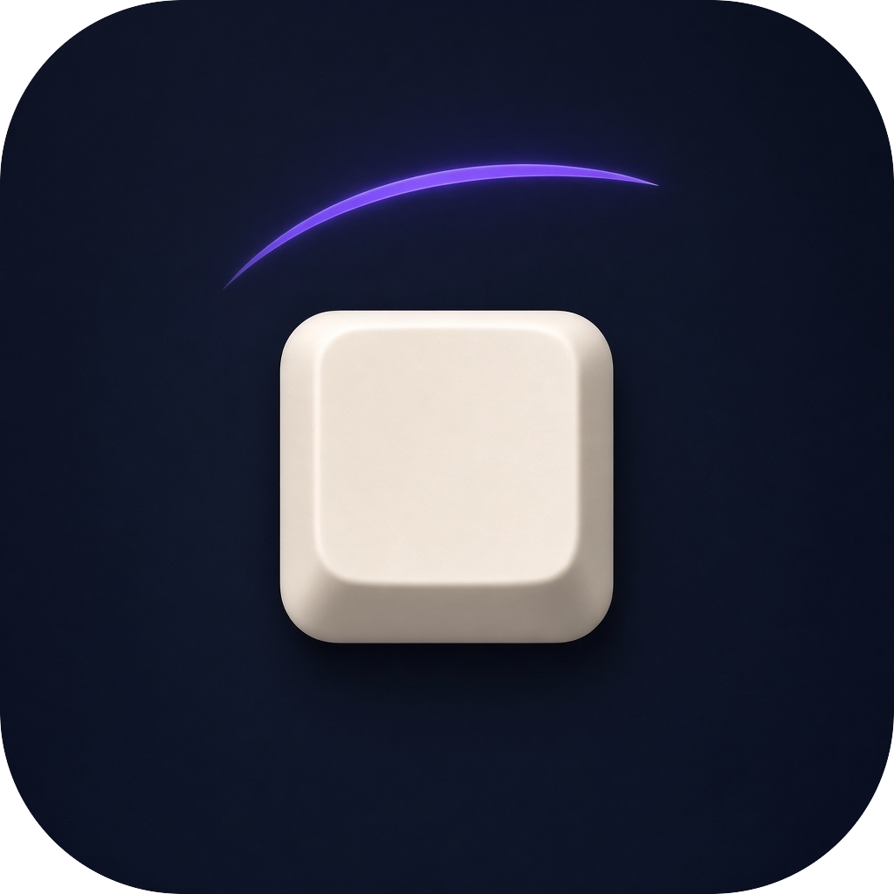

# keycount

An Omarchy shell plugin that displays live typing speed, the personal best, its date, and the current best-beating streak.

## Install

Install the public repository with Omarchy.

```sh
omarchy plugin add https://github.com/noobyco/keycount.git --enable
```

Keycount uses Hyprland's Lua keyboard event callback. When the panel loads, it writes a small user-owned module at `~/.config/hypr/keycount.lua` if needed and reloads Hyprland when that file changes. It does not read `/dev/input`, add the user to a Linux group, require a password, or require a logout.

Speed is the number of words typed during the current run, divided by the minutes in that run. A word is a run of letters or digits. An apostrophe or hyphen inside that run stays part of the word, so `don't` and `well-known` each count as one. Space and punctuation separate words. Enter, Tab, Shift, Ctrl, Alt, Super, arrows, and shortcuts do not insert characters. Backspace and Delete remove the last character. A word you are still typing counts. The key labels follow the English (US) layout, including the number row and the numpad digits.

The live number stays at 0 until you type, and it returns to 0 after two seconds without a key. That pause does not change the saved best, date, or streak. A run replaces the best only when it has at least two words, lasts at least one second, and is faster than the saved best. The streak then increases by one.

During installation, Omarchy adds and reloads the following shortcut in `~/.config/hypr/bindings.lua` if no equivalent Keycount panel binding already exists:

```lua
o.bind("SUPER + SHIFT + K", "Toggle Keycount", {
  panel = "io.github.noobyco.keycount"
})
```

The installer never executes plugin code, rewrites unrelated keybindings, or duplicates a manually-created equivalent binding.

## Placement

On the first enabled session, Keycount opens a theme-aware placement picker when no saved position is valid. Top Center is selected by default. The buttons follow the screen, left to right and top to bottom:

```
Top Left      Top Center      Top Right
Left Center   Center          Right Center
Bottom Left   Bottom Center   Bottom Right
```

With the counter open, **Change layout** shows the same menu. Choosing a position closes the menu and saves that position. The best, date, and streak stay as they are.

The chosen position and typing statistics are saved together in `~/.config/omarchy/keycount.json`.

```json
{
  "position": "top-center",
  "bestSpeed": 72,
  "bestDate": "2026-11-03",
  "streak": 1
}
```

Supported values are `top-left-edge`, `top-center`, `top-right-edge`, `left-center`, `center`, `right-center`, `bottom-left-edge`, `bottom-center`, and `bottom-right-edge`.

The panel uses Omarchy's live `Commons.Color` and `Style` values, so it follows the active theme without a plugin-specific palette.

## Validate

Run these checks from the repository root before publishing changes.

```sh
omarchy plugin validate .
qmllint -I "$OMARCHY_PATH/shell" Keycount.qml
node tests/test_model.js
python3 -m unittest tests.test_setup
```

## Remove

```sh
python3 ~/.config/omarchy/plugins/io.github.noobyco.keycount/keycount_setup.py --remove-binding --remove-hyprland-bridge
omarchy plugin remove io.github.noobyco.keycount
```
